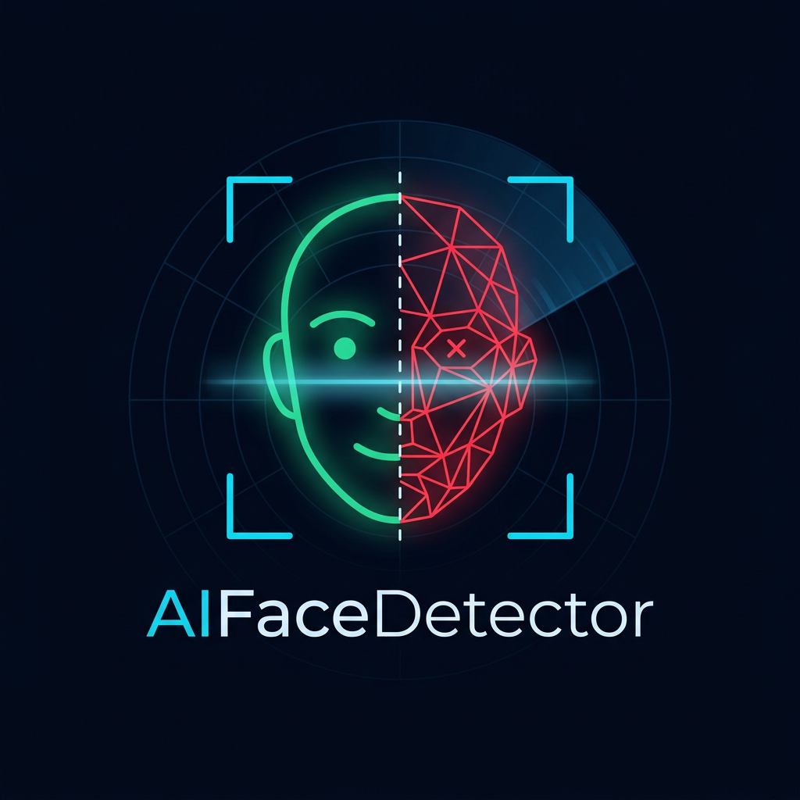
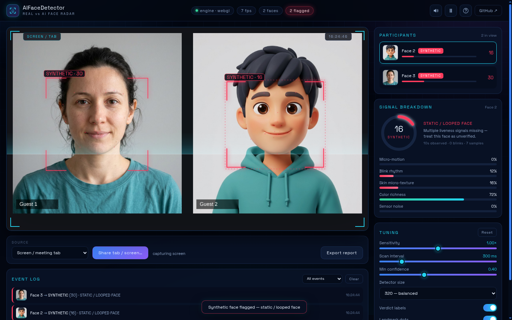
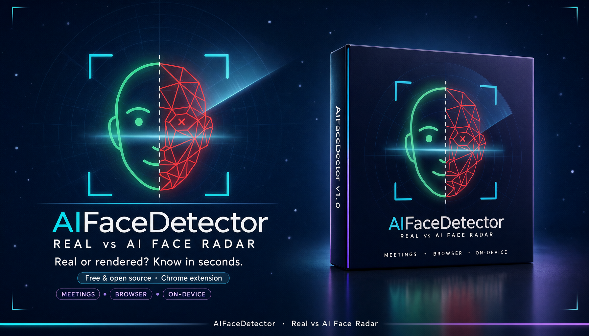

<div align="center">

<picture><source media="(prefers-color-scheme: dark)" srcset="promo/logo-white.png"></picture>

# AIFaceDetector — Real vs AI Face Radar

</div>



Open-source Chrome extension (Manifest V3) that flags **AI-generated, animated and static faces** in your video meetings, in any browser tab you share, or on your own webcam — entirely on-device. Every face in view gets a live verdict: **REAL**, **SUSPECT** or **SYNTHETIC**, with a five-signal breakdown you can inspect.

No cloud. No uploads. No frame ever leaves your machine.

## What it does

- **Meeting radar** — share your Meet / Zoom / Teams tab (or any window / screen) and every participant tile gets its own verdict box, name-agnostic and live.
- **Browse radar** — the same capture works on any tab: videos, profiles, streams, dating apps, video calls.
- **Webcam check** — point it at yourself (or any camera) to see a live human score high.
- **Demo reel** — a bundled AI-generated photo and a 3D animated avatar, labeled with ground truth, so you can watch the radar flag both within seconds of installing.
- **Five liveness signals per face**, shown as live meters:
  1. **Micro-motion** — natural landmark jitter vs a frozen rig.
  2. **Blink rhythm** — eye-aspect-ratio dips over time.
  3. **Skin micro-texture** — high-frequency detail on non-edge skin regions; generative models over-smooth it.
  4. **Color richness** — quantized palettes and flat shading expose rendered avatars.
  5. **Sensor noise** — frame-to-frame grain real cameras always carry.
- **Verdict dial + subtype** — `STATIC / LOOPED FACE`, `ANIMATED AVATAR` or `AI-GENERATED LIKENESS`, with plain-language advice.
- **Participants panel** — every tracked face with thumbnail, score bar and verdict; click one (or click its box on the video) to inspect its signals.
- **Synthetic alerts** — red pulse box, screen flash and beep when a face crosses into SYNTHETIC (5 s cooldown).
- **Event log** — every verdict change, filterable (all / synthetic / real), capped at 100.
- **Export report** — one click downloads a JSON report: verdicts, signal values, observation stats, tuning and event history.
- **Tuning deck** — sensitivity (live re-scores every face), scan interval, min confidence, detector size, labels, landmark dots, mirror, alerts.
- **Background-safe scanning** — when you switch back to the meeting tab, analysis keeps running (the scan loop draws frames itself instead of relying on `requestAnimationFrame`, which Chrome suspends in background tabs).
- Keyboard: `Space` pause · `M` mirror · `S` sound · `?` help · `Esc` close.

## Install (load unpacked)

1. Clone or download this repo.
2. Open `chrome://extensions`, enable **Developer mode**.
3. **Load unpacked** → select the `aifacedetector` folder.
4. Click the toolbar icon. The demo reel starts immediately and both synthetic subjects get flagged.

## Scan a meeting

1. Join the meeting in a normal Chrome tab.
2. In AIFaceDetector choose **Source → Screen / meeting tab**, press **Share tab / screen…**.
3. In Chrome's picker select the **meeting tab** (tab capture keeps working when you switch back to it).
4. Read the boxes: green **REAL**, amber **SUSPECT**, red **SYNTHETIC**. Click any face for the signal breakdown.

The same flow works for any window or the whole screen — whatever is visible gets scanned.

## How the verdict is computed

Each face track accumulates ~5 s of samples, then:

```
authenticity = 100 × ( 0.24·micro + 0.16·blink + 0.24·texture
                     + 0.14·color + 0.22·temporal ) × sensitivity
```

- **≥ 64 → REAL** · **38–63 → SUSPECT** · **< 38 → SYNTHETIC**
- Signals are normalized 0–1 heuristics measured on a 160×160 face crop and on pose-normalized 68-point landmarks (translation, scale and roll removed, so panning/zooming a photo doesn't fake micro-motion).
- The sensitivity slider multiplies the score and **re-evaluates every live track instantly**, so you can feel the trade-off.

## Honest limits (read this)

This is an **on-device heuristic triage tool, not a forensic deepfake classifier**:

- Heavy video compression, beauty filters, bad lighting or a very still participant can lower a real person's score → treat **SUSPECT** as "look closer", never as proof.
- Sophisticated real-time deepfakes that preserve motion and noise can pass.
- Static photos, looped videos and rendered avatars are the strong cases — and the most common ones in casual meetings.
- Use it responsibly and with consent; check your local laws before analyzing other people.

## Privacy

- All inference is local (bundled face-api.js / TensorFlow.js, WebGL with CPU fallback). The only "network" is the screen/webcam stream you explicitly share, and it never leaves the browser.
- No host permissions, no content scripts, no analytics. `storage` is used only for tuning preferences.
- Bundled demo subjects are **AI-generated fictional people**, not real individuals.

## Tech notes

- Manifest V3, no build step. face-api.js is CSP-clean (no `eval` / `new Function`).
- Detection: TinyFaceDetector + 68 landmarks on a `setTimeout` scheduler with a busy flag; the loop also draws the current video frame so background tabs keep analyzing at ~1 Hz.
- Tracks associate by box-center distance, lerp-smoothed, pruned after 900 ms; verdict changes log once, not per frame.
- Skin-noise measurement excludes edge pixels (local range ≥ 18) so crisp cartoon edges don't masquerade as skin texture.

## Layout

```
aifacedetector/
├── manifest.json        MV3 manifest (storage only)
├── background.js        toolbar icon → dashboard tab
├── app.html             dashboard UI
├── css/                 styles + bundled font
├── js/
│   ├── app.js           UI, tracks, HUD, scan loop, report
│   ├── analysis.js      five-signal authenticity engine
│   ├── engine.js        model loading + detection
│   ├── sources.js       demo reel / webcam / screen capture
│   └── audio.js         UI/alert sounds
├── vendor/              face-api.js + detector/landmark weights
├── assets/              AI-generated demo subjects
├── promo/               logo, software box, poster, banner, video
└── docs/                screenshots
```

## Promo kit

All assets are AI-generated artwork for this project — free to reuse under the same MIT license.

| Asset | File |
| --- | --- |
| Logo | [`promo/logo.png`](promo/logo.png) |
| Logo (dark mode) | [`promo/logo-white.png`](promo/logo-white.png) |
| Software box | [`promo/software-box.png`](promo/software-box.png) |
| Poster | [`promo/poster.png`](promo/poster.png) |
| Banner | [`promo/banner.png`](promo/banner.png) |
| Promo video (8 s, 1080p) | [`promo/promo.mp4`](promo/promo.mp4) |



## License

MIT © 2026 aisac-id. Bundled [face-api.js](https://github.com/justadudewhohacks/face-api.js) is MIT © justadudewhohacks. See [LICENSE](LICENSE).